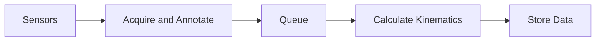
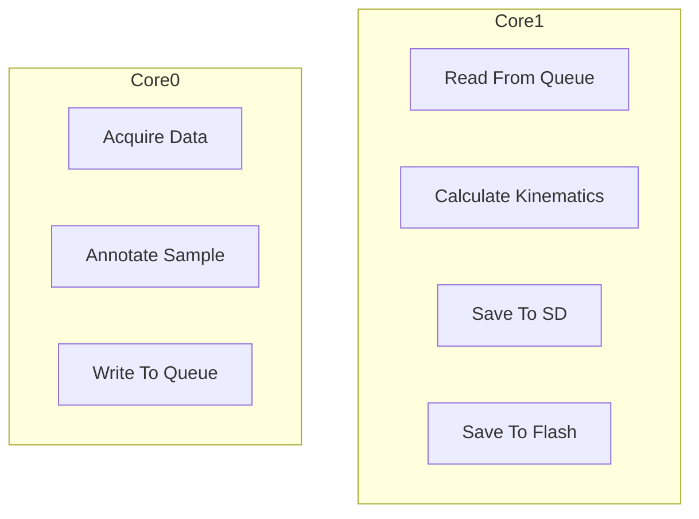
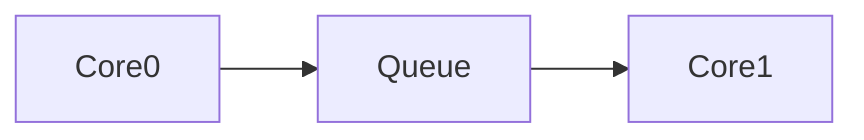

# Bethel University Sensor Suite Code 24/25

For part C in the [High Thrust Challenge from the Midwest Rocketry Competition 2024/2025](https://dept.aem.umn.edu/mnsgc/Space_Grant_Midwest_Rocketry_Competition_2024_2025/Midwest_Rocketry_Competition_Handbook_2024-2025_v5.pdf#page=4). Includes the optional challenge of using a Pitot Tube.  

Deduces altitude, speed, and acceleration during a High-Powered Rocket's ascent in 4 independent methods (barometric pressure, 3-axis acceleration, gps, differential pressure)

## Architecture

The code was designed to be a dual-core system with a focus on sensor sampling/saving throughput.

### Dataflow

The data is pipelined with minimal branching for maximum throughput. Due to the nature of the challenge, all data will broadly be saved the same way.



### Core Allocation

As this is a dual-core system which needs to be as robust as possible, each core has distinct responsibilities which do not overlap. This makes thread-safety easier to ensure, and streamlines dataflow.

#### Core Responsibilities

To minimize latency and maximize sensor sample throughput, core0's primary responsibility is simply reading samples with light preprocessing.  
This then means that doing calculations, and saving the data, is the responsibility of core1.



#### Inter Core Communication

As both cores read from the same memory independently, there needs to be a method of communication between them. A circular queue system was decided, with atomics ensuring thread-safety.



## Optimizations

As the main goal of the challenge was to save data at as high a sampling rate as possible, the optimizations reflect this. However, some optimizations are for the stability of the system.

### Multicore

Since there are several stages that can happen in parallel, it makes sense to split the work between both of the Pico 2's cores.  

A good balance was found to have core0 dedicated entirely to collecting and preprocessing samples, while core1 did the necessary calculations and saved the final data. Due to the non-instant sampling rate of the sensors, core1 was able to keep up with core0 despite the computational workload difference.

#### Thread-Safe Circular Queue

It was determined that a queue would be the best way to pass data between the two cores. Since core0 only had to write data and core1 only had to read a more complicated method was not needed.  

To ensure the system is stable atomic counters are used to keep track of the size of the queue.  

To minimize time spent determining how to wrap the circular queue, its size is a power of 2 to enable simple bitwise AND for wrapping.

### Custom Sensor Drivers

After reviewing standard implementations of sensor drivers it was noticed that they were not always geared towards the most efficient method of data collection for this use-case.

Generally, as not all received samples are new, applying the relatively computationally expensive formula to convert the raw bits to a usable value is not necessary for each attempted read.  

## Limitations

As this code is specialized for sensor sample saving throughput, as well as stability, it does have several limitations that were considered necessary or extremely unlikely edge-cases.

### Single Core Flash Writing

Since flash memory cannot execute code as well as be written to at the same time on the Pico 2, when core1 needs to save to flash memory core0 needs to be locked out of running until the memory is saved.  

Due to the very quick nature of writing to the flash memory, this ended up having little impact on the overall sensor sample throughput.

### Core Throttling

It was assumed both cores would be fully functional at all execution times. This means that if core0 or core1 fail, the data pipeline will stall until the core recovers.  

Specifically, if core1 fails, core0 will fill the queue then be idle.  

If core0 fails, core1 will empty the queue then be idle.

## Retrospective

Over the course of writing this repository, much was learned about how embedded systems run. There are many differences between an embedded environment and a more standard programming environment.

### Writing Sensor Drivers

Since most sensors use standard communication protocols, communicating with any sensor is very similar. This means that main difficulty in writing a sensor driver is knowing what the sensor is actually capable of. And how you want to represent that capability to the end user.

#### Reading Datasheets

Datasheets for sensors are normally very detailed, although a lot of that detail is not useful for writing a driver.  

To perhaps overly simplify, the primary information needed is what registers to access for data, and what ones to access for configuring the sensor.

There were a few cases - specifically when reading on the GTU7 gps module being used - where the datasheet was much less useful, and was not clear on how to interface with the sensor. It turned out that datasheet assumed the user knew the standard way gps's communicate.

### Separation of Concerns

Due to poor separation of concerns, when the MPU6050 accelerometer had to be switched to an ADXL377 accelerometer, it was more complicated than it should have been.  

The main file, collecting samples from sensors, does some repetitive work that each sensor driver should do itself. 

## Lite User Guide

This section is primarily meant to give the reader some context around design decisions, not necessarily explain how to actually use the code. It is assumed that with the conclusion of the challenge, this code will only have a use as something to be  reviewed.

### Annotated Sample Format

As only the upwards component of any sensor was needed, each sensor could be used to get one float every time it was sampled. This allowed each sample to be treated uniformly, with annotations given as follows:

```
    elapsedTime         -> time since this sensor was last sampled (microseconds)
    aggSampleNum        -> what # sample is this, including other sensors
    sensorSampleNum     -> what # sample this is, from this sensor
    sensorNum           -> unique ID of this sensor
    sensorMax           -> max unique ID (inclusive)
    sensorSample        -> the actual float representing the sample
    data                -> where the 3 values (altitude, speed, acceleration) will be stored
    sigDecimalDigits    -> how many decimal places to truncate the data to
```

The sensor ID allows future code to know how to treat the ```sensorSample``` - whether it represents altitude, speed, or acceleration. From there the other two can be derived.  

### Building With VSCode

- Ensure the ```Raspberry Pi Pico Project``` extension is installed.
- Ensure the pico toolchain is selected as the compiler
- Use Pico SDK 2.1.1
- build all projects with cmake